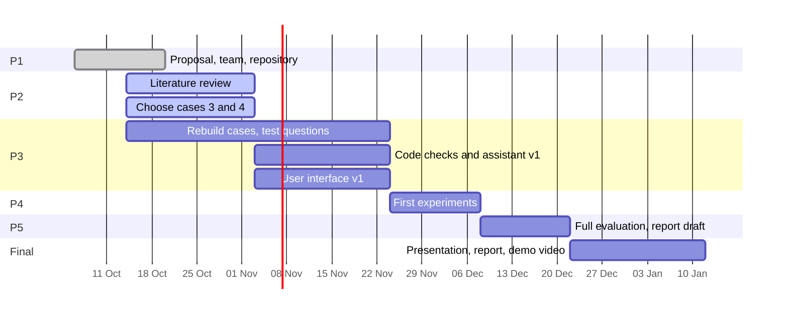

# Progress

Last update: 20 Oct 2026

## Milestones

| Milestone | Date | Deliverables | Status |
|---|---|---|---|
| **P1** | 20 Oct | Proposal, team, GitHub repository | ✅ done |
| **P2** | 3 Nov | Literature review, all four cases chosen | 🔄 in progress |
| **P3** | 24 Nov | Cases rebuilt, test questions, first version of the assistant | ⏳ planned |
| **P4** | 8 Dec | First experiments | ⏳ planned |
| **P5** | 22 Dec | Full evaluation, report draft | ⏳ planned |
| **Final** | 12 Jan | Final presentation, report, demo video | ⏳ planned |

## Timeline

Tasks and owners are tracked as [issues](../../issues), grouped by [milestone](../../milestones).

## Cases

| Case | Industry | Source | Owner | Status |
|---|---|---|---|---|
| 1 | Semiconductor fab (large company) | SMT2020 testbed (Kopp et al. 2020); expert results from Tassel et al. 2023 | Melisa Subasi | chosen · first reproduction: 28 of 28 published values within tolerance |
| 2 | Sheet-metal job shop (SME) | JaamSim model and 30-replication results, Jurczyk-Bunkowska 2026 (Zenodo) | Yu Han | chosen · reproduction identical to the published replications |
| 3 | New industry | to be chosen | Meron Hagos | searching |
| 4 | New industry (test case) | to be chosen | Alejandro Rivas | searching |

Case 4 is the held-out test case: its test questions are written separately and kept out of this repository until the final evaluation.

## Log

- **20 Oct 2026** · Proposal submitted (P1). Repository published.
- **16–17 Oct 2026** · Case 1: open-source SMT2020 simulator set up; four published scenarios (HVLM / LVHM × FIFO / critical ratio) run with 6 seeds each; all 28 values of Tassel et al. (2023, Table 1) within tolerance. See [`cases/A1_smt2020/`](cases/A1_smt2020/).
- **14 Oct 2026** · Case 2: published JaamSim model run headless; 30 replications identical to the authors' published results (overtime 3.31 h normal week, 11.54 h with 20 % more orders). See [`cases/A2_sme/`](cases/A2_sme/).
