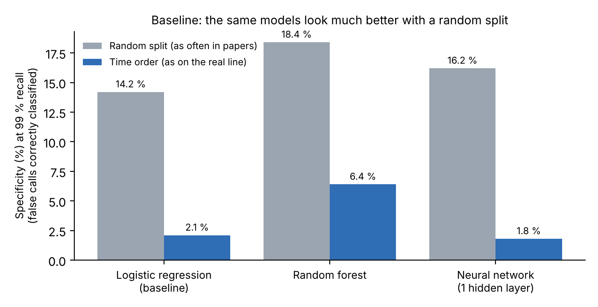

# Second Check of AOI Results with Supervised Machine Learning

**Binary classification of AOI alarms into true defects and false calls (Siemens production data)**

[](https://github.com/bodhi584/aoi-decision-gate/actions/workflows/ci.yml)

Case Study *Intelligent Systems in Production* · Technische Hochschule Deggendorf (THD) · Team 1 · guided by Dr. Hamidreza Heidari
Yu Han (team lead) · Melisa Subasi · Meron Hagos · Alejandro Rivas

📄 One-page proposal: [`docs/proposal.pdf`](docs/proposal.pdf) ([Word](docs/proposal.docx)) · slides: [`docs/slides_revised_topic.pdf`](docs/slides_revised_topic.pdf) · progress and milestones: [`PROGRESS.md`](PROGRESS.md)

Based on the lecture example **“Siemens – Quality Control and Defect Detection”** (lecture slides, p. 18).

**Aim:** this project aims to reduce false calls after automated optical inspection (AOI): a binary classifier decides for each AOI alarm whether it is a true defect or a false call, while at most 1 % of true defects are classified as false call (recall ≥ 99 %).

**Key motivation:** fewer manual re-inspections of false calls (operator time, throughput), while true defects are still caught. Every number on this page comes from a cited source or from a result file in [`results/`](results/).

---

## 1. The industrial problem

After soldering, an **automated optical inspection (AOI)** machine checks every board with a camera. It measures each solder joint (height, offset, polarity, …) and compares each value with fixed limits. If one value is outside its limit, the board goes to a **manual inspection station**, where an operator checks it.

**Most of these alarms are false.** In the Siemens production data used here, about **98 %** of the flagged boards are fine (*false calls*); only about 2 % have a real defect ([`results/data_facts.json`](results/data_facts.json)). The data authors from Siemens describe this as “a major manual labour effort” (Pfab et al. 2024).

**It is a current problem, not a past one:**

| Date | Source | What it says |
|---|---|---|
| 21 Oct 2026 | Siemens press release with NVIDIA | AI second check of AOI results at the **Siemens electronics factory in Erlangen**: when the AOI flags a possible defect, AI decides “whether it represents a real defect or a false call”. Project targets: about **40 % fewer false calls**, **reduced manual verification**. |
| 19 Oct 2026 | Siemens (C. Neike), Erlangen, reported by technology.org | Factories in high-wage countries need **7–9 % more productivity every year**; Siemens invests €500 million in the Erlangen site as a showcase for AI in manufacturing. |
| 2024 | Pfab et al., Siemens AG, *Data in Brief* | Siemens publishes 132 days of AOI data from a real line so that false-call reduction can be studied on real data. |

> **Why this problem and not image-based defect detection?** The AOI machine is already the computer-vision system and stays on the line. The open problem is the step after it: too many false alarms go to people. This is the step Siemens is working on now.

## 2. Key factors

| Factor | Why it matters |
|---|---|
| False-call rate | Each false call costs operator time at the manual station |
| Missed defects | A released defective board reaches the customer; this must stay very low |
| Drift over time | Material batches, machine settings and products change; a model trained last month may no longer fit |
| Class imbalance | Only about 1 % of flagged joints are real defects |
| Label quality | Labels come from operators and may contain errors (Pfab et al. 2024) |

## 3. Input → System → Output


| | |
|---|---|
| **Input** | AOI alarm (one flagged board): measurements of each flagged solder joint (about 70 values), inspection type, component type, AOI error code |
| **System** | Binary classification (supervised machine learning) trained on past manual-inspection results; classification threshold set for a recall of at least 99 % on true defects |
| **Output** | Per board: is the AOI alarm real? **True defect** (→ manual inspection, repair) or **false call** (→ skip manual inspection) |
| **Impact** | Less manual inspection work (cost, throughput) without lowering quality |

> **Why these labels?** They are produced every day at the manual station anyway, so no extra labelling is needed in a factory.

## 4. Methodology

We follow **CRISP-DM** (Cross-Industry Standard Process for Data Mining; Chapman et al. 2000), the standard process for industrial data projects:

| CRISP-DM phase | What we do |
|---|---|
| Business understanding | False-call problem, KPIs and limits (sections 1, 2, 7) |
| Data understanding | Siemens AOI data: structure, imbalance, drift ([`results/data_facts.json`](results/data_facts.json)) |
| Data preparation | Group joints into boards, encode categories, split strictly by time |
| Modelling | Three standard models (scikit-learn): logistic regression (baseline), random forest, neural network with one hidden layer (lecture p. 12, 17) |
| Evaluation | **Day-by-day simulation** of the line (section 6): precision, recall, defective boards released, manual inspections saved |
| Deployment | Demo video and run instructions (P5) |

**Day-by-day simulation.** The recorded days are played back in time order. On each day every flagged board is classified by a model trained only on earlier days, exactly as on the real line. We compare training once with retraining every week. Code: [`aoi_classification/replay.py`](aoi_classification/replay.py); step by step: [`model_training.ipynb`](model_training.ipynb).

> **Why a day-by-day simulation instead of a random train/test split?** A random split mixes future and past. It looks much better than reality on this data (section 6), so it would overstate what a factory gets.

## 5. Data

| | |
|---|---|
| Source | Pfab, Eichler, Mallandur, Rothering (2024), Siemens AG, *Data in Brief* 53, 110110 |
| Repository | Mendeley Data, DOI [10.17632/99jzmh9658.2](https://data.mendeley.com/datasets/99jzmh9658/2) |
| Content | 440,274 flagged solder joints on 39,742 boards, 5 inspection types, about 70 AOI measurements, 4 categorical fields (e.g. component type, error code); label: false call / true defect |
| Period | 132 days of one production line of Siemens AG in Bavaria (101 days with records) |
| Drift | A classifier can tell the first 30 % of days from the last 30 % from the measurements alone with AUROC 0.974: the line changes strongly over time |
| Licence | CC BY-NC 3.0, owned by Siemens AG: **not stored here**; [`scripts/download_data.py`](scripts/download_data.py) downloads it and checks the checksum |

## 6. First results

**Baseline** ([`scripts/run_baseline.py`](scripts/run_baseline.py), [`results/baseline.json`](results/baseline.json)): each model is trained on the first 70 % of the records and tested on the rest (time order), compared with a random split. The number is the **specificity** (share of false calls correctly classified as false call, i.e. manual inspections that could be skipped) at 99 % **recall** (99 % of defective boards still classified as true defect); positive class = true defect.

| Model | Random 70/30 split (as often done in papers) | **Time order (as on the real line)** |
|---|---|---|
| Logistic regression (baseline) | 14.2 % | **2.1 %** |
| Random forest | 18.4 % | **6.4 %** |
| Neural network (one hidden layer) | 16.2 % | **1.8 %** |

These rates are read from the test period itself, so they are an upper bound.



**Day-by-day simulation** ([`scripts/run_replay.py`](scripts/run_replay.py), [`results/replay.json`](results/replay.json)): second half of the records (39 production days, 17,366 flagged boards), thresholds set on past days only.

| Model | Training | Specificity: false calls correctly classified (manual inspections saved) | True defects missed (1 − recall) |
|---|---|---|---|
| Logistic regression | once | 15.0 % (2,523) | **3.38 %** (20 of 592) |
| Logistic regression | every week | 11.6 % (1,949) | **2.20 %** (13 of 592) |
| Random forest | once | 9.9 % (1,658) | **2.20 %** (13 of 592) |
| Random forest | every week | 13.1 % (2,203) | **3.55 %** (21 of 592) |
| Neural network | once | 11.9 % (1,996) | **3.21 %** (19 of 592) |
| Neural network | every week | 6.5 % (1,098) | **3.72 %** (22 of 592) |


**What this shows:** all three models save manual inspections (specificity 6.5–15.0 %), but none keeps 99 % recall on later days (96.3–97.8 %), because the line changes over time. Handling these changes is the main challenge for the next milestones.

## What we deliver

A **software prototype**, not a product installed in a factory:

| Deliverable | What it is |
|---|---|
| **Classifier** | A Python package (`aoi_classification/`): train on past manual-inspection results, classify each flagged board (true defect or false call), simulate the line day by day |
| **Notebook** | [`model_training.ipynb`](model_training.ipynb): the three models step by step, with precision, recall and the confusion matrix |
| **Evidence** | Result files for every reported number, tests on every push, demo video, final report |

In a factory the classifier would run between the AOI machine and the manual inspection station; connecting it to a real line is not part of the course project. 

## 7. Goals and KPIs

| KPI | Baseline (time order) | Target (12 Jan) |
|---|---|---|
| Recall (true defects classified as true defect) | 96.3–97.8 % (day-by-day simulation) | **≥ 99 %** |
| Specificity (false calls classified as false call = manual inspections saved) | 6.4 % (best model at 99 % recall, time order) | **≥ 20 %** |

Targets are fixed now, before the main experiments.

## 8. Conditions and limitations

- One Siemens production line, five inspection types, 132 days.
- Measurements are anonymised (scaled to 0–1, no physical names), so explanations can name a feature but not its physical meaning.
- Labels come from operators and may contain errors.
- No images: the classifier works on AOI measurements, not on camera images.
- Data licence is non-commercial (course use only); no personal data.
- Main risk: the line changes over time, so the 1 % limit may not hold on later days. Fallback: report what works, what does not, and why.

## Future work

The next step after the course is a real line with an industry partner: (1) an electronics plant shares AOI and manual-inspection records under a data agreement; (2) an interface reads each board's AOI result from the machine or MES (for example via the IPC-CFX standard or a vendor export) and sends the classification to the repair station; (3) **shadow mode**: the classifier runs next to the operators and only logs its decisions; (4) the plant's quality engineers compare the logs and approve go-live, starting with one inspection type.

## 9. Timeline


Milestones follow the course requirements for the Software & Simulation track; details in [`PROGRESS.md`](PROGRESS.md). Tasks are tracked as [issues](../../issues).

## 10. Run it

Runs on **Windows, macOS and Linux** (Python 3.11 or newer, no graphics card). The tests run on all three systems on every push.

```bash
git clone https://github.com/bodhi584/aoi-decision-gate
cd aoi-decision-gate
pip install -r requirements.txt pytest
python -m pytest -q                  # unit tests (synthetic data)
python scripts/download_data.py      # Siemens data, about 330 MB
python scripts/run_baseline.py       # results/baseline.json
python scripts/run_replay.py         # results/replay*.json / .csv (about 10 min)
python scripts/make_figures.py       # docs/img/*.png
```

## 11. Repository

```
aoi_classification/   data loading, binary classifier (model + threshold), day-by-day simulation
scripts/    data download, baseline, simulation, figures
tests/      unit tests (run automatically on every push)
results/    result files of every run shown on this page
docs/       proposal, figures
```

## References

- Pfab, K., Eichler, R., Mallandur, A., Rothering, M. (2024). Data of automated optical inspection of surface-mounted technology electronic production. *Data in Brief* 53, 110110. doi:10.1016/j.dib.2024.110110
- Siemens (21 Oct 2026). *Siemens and NVIDIA advance AI-powered PCB inspection from digital twin to factory.* Press release. https://news.siemens.com/en-us/siemens-nvidia-pcba-digital-twin-factory/
- technology.org (20 Oct 2026). *Siemens aims to raise factory automation to 80 % with AI.* https://www.technology.org/2026/10/20/siemens-ai-factory-automation-80-percent-erlangen-neike/
- Albayari, J., Patra, P., Patel, D., Santos, D. (2025). Enhancing false call detection in automated optical inspection using XGBoost classifier and XAI algorithms. *FAIM 2025*, Springer. doi:10.1007/978-3-032-05610-8_51
- Schmitt, J., Bönig, J., Borggräfe, T., Beitinger, G., Deuse, J. (2020). Predictive model-based quality inspection using machine learning and edge cloud computing. *Advanced Engineering Informatics* 45, 101101.
- Chapman, P. et al. (2000). *CRISP-DM 1.0: Step-by-step data mining guide.* SPSS.
- Lecture slides, Case Study Intelligent Systems in Production, p. 18 (Siemens – Quality Control and Defect Detection).

## License

Code: MIT. The Siemens data are not part of this repository and keep their own licence (CC BY-NC 3.0).
