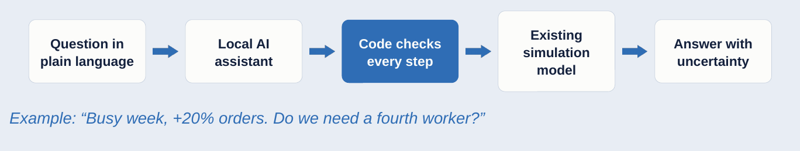

# Planner Copilot

**A local AI assistant for production planning simulations**

Case Study *Intelligent Systems in Production* · Technische Hochschule Deggendorf (THD) · Team 1 · guided by Dr. Hamidreza Heidari
Yu Han · Melisa Subasi · Meron Hagos · Alejandro Rivas

📄 Proposal slides: [`docs/P1_proposal_presentation.pdf`](docs/P1_proposal_presentation.pdf) · one-page proposal: [`docs/proposal.md`](docs/proposal.md) · progress: [`PROGRESS.md`](PROGRESS.md)

This page is our proposal in long form. Every section answers **what** we do and **why**. Each reason is backed by a source (paper and page), by our own results (linked file), or is marked as **our own setting** with the reasoning behind it. Terms are explained in the [glossary](#glossary); sources are listed under [references](#references).

---

## 1. The problem
**Good production planning needs simulation, and experts.**

- A busy week, missing workers or a broken machine: a simulation shows what will happen before it does.
- Today mostly only a simulation expert can run it correctly, and small companies often have none.
- An AI chatbot alone cannot plan production, and nobody can check its answer without an expert.

**Key motivations:** small companies get answers without a simulation expert · large companies save expert time · company data stays in-house · reliable AI help for planning is needed now.

> **Why simulation and not a spreadsheet?** Workers, machines and orders interact: when two machines need the same worker, one of them waits. A spreadsheet adds up average times and misses this waiting. Example from our Case 2: a spreadsheet estimate gives no overtime for a normal week, while the published simulation shows 3.3 hours of overtime and about 4 unfinished orders.
>
> **Why is an expert needed to run it?** Changing a validated model correctly takes expert knowledge. One simulation run is not an answer: five runs of the same model can give average delays from 1.8 to 10.4 minutes (Law 2023, p. 1488), so the expert decides how many runs are needed and reports a confidence interval. A model is also valid only for the conditions it was tested for (Sargent 2015, p. 1729), so the expert knows which questions it may answer.
>
> **Why can't an AI chatbot do it alone?** A language model produces plausible text, not calculated results. Language models cannot plan reliably on their own, and cannot reliably check their own plans (Kambhampati et al. 2024). Without an expert, nobody notices when the answer is wrong.

## 2. Project scope
**Aim:** test whether a local AI assistant with code checks can answer planning questions at the level of published expert simulations.

| Includes | Out of scope (current phase) |
|---|---|
| About 4 published simulation cases | A company's own production data and models |
| Test questions with correct answers | Commercial simulation tools |
| A local AI assistant with code checks | Use in a real factory |
| Comparison of three setups | |

> **Why published cases?** They come with expert results that were peer-reviewed or published with the model files. That gives us an objective reference to grade against, and anyone can repeat our tests with public data.
>
> **Why "at the level of published experts" and not "better than experts"?** The assistant does not replace the simulation method; it replaces the person who operates the model. Reaching the expert's result is the success criterion.
>
> **Why are company data, commercial tools and real factories out of scope?** Company data needs a validated company model and data agreements; commercial tools (e.g. Plant Simulation) need licences and cannot be shared openly; a real-factory trial needs time and safety approval beyond one semester. We keep them as future work.

## 3. Goals: three measurable targets

| Target | Measure | Meaning |
|---|---|---|
| **≥ 90 %** | Close to the expert | For questions with an answer, the AI's answer is close to the expert's answer. |
| **≤ 2 %** | Confidently wrong | The AI gives a wrong answer and sounds sure. This is the most dangerous error. |
| **≥ 90 %** | Correct refusals | When a question cannot be answered, the AI says so instead of guessing. |

> **Why these three measures?** They cover the three things that can happen to a planner: a useful answer, a dangerous answer, or an honest "I can't answer that". Accuracy alone would hide the dangerous answers.
>
> **Why is "confidently wrong" the most important?** A plant manager acts on a confident number, for example by hiring or cancelling overtime. A cautious answer costs time; a confidently wrong one costs money. Simulation validation treats the same error the same way: accepting an invalid model as valid is the *model user's risk*, which "must be kept small" (Sargent, Goldsman and Yaacoub 2016, p. 171). A confidently wrong answer is that error at the level of a single question, so its limit is the strictest (≤ 2 %).
>
> **What does "close to the expert" mean?** Within the wider of ±5 % or ±2 standard deviations of the published result. Comparable studies accept 5–10 % deviation from the reference model (Schmitt et al. 2026, p. 648), and simulation validation requires the accepted accuracy to be fixed before testing (Sargent 2015, p. 1730). We fix ours now, before any experiment.
>
> **Why should the AI refuse at all?** A language model tends to answer every question, even when it should not. The research literature on this problem states that models should "ideally abstain", i.e. refuse, when they cannot answer reliably (Wen et al. 2025, p. 529). A simulation model can answer only what it models (e.g. it has no costs in euros), so refusing those questions is part of a correct answer.
>
> **Why 90 % and 2 %, and not 85 % or 95 %?** The values are **our own setting**, fixed before any experiment as validation practice requires (Sargent 2015, p. 1730), so they cannot be adjusted to fit our results. Four arguments set them:
>
> 1. **Comparable systems.** The two published systems closest to ours, where a language model drives a simulation with code-side checks, report 92.6 % correct values with a local 12-billion-parameter model (Mylonas et al. 2026, p. 4) and 388 of 400 correct runs (97 %) with 26–35-billion-parameter models (Monks et al. 2026, p. 21). Our models are smaller (7–9 billion), so a target slightly below theirs is ambitious but realistic. Both are preprints and measure similar, not identical things.
> 2. **What our measurement can resolve.** With about 80 test questions, a result of 85 % has a 95 % confidence interval of about 76–91 %, 90 % about 82–95 %, and 95 % about 88–98 % (Wilson interval, our calculation). The intervals overlap, so 85, 90 and 95 cannot be told apart reliably. The target is a round value in the realistic range; we always report the confidence interval, never the point value alone.
> 3. **Quality management.** The targets are deliberately asymmetric, following the logic of failure mode and effects analysis (FMEA), which ranks a failure by severity, occurrence and detection (AIAG and VDA 2019). A confidently wrong answer is severe and hard to detect, so it gets the strictest limit; a cautious answer is noticed at once by the planner, so a looser limit is acceptable. Six Sigma levels (3.4 defects per million) are not meaningful here: they need millions of repetitions, while about 80 questions cannot resolve rates below a few percent. For comparison, 90 % correct corresponds to about 2.8 σ and 2 % errors to about 3.6 σ.
> 4. **Our feasibility test.** In a first small test (October 2026, 40 questions, one 7-billion-parameter model), the AI with the simulation but without our checks answered 50 % correctly and was confidently wrong in 40 %; with the checks it answered 95 % correctly with 2.5 % confidently wrong ([`docs/feasibility_test.md`](docs/feasibility_test.md)). 90 % lies clearly above the unchecked setup and leaves room for the harder held-out case.
>
> **Can ≤ 2 % be proven?** Not with 80 questions: even zero confidently wrong answers out of 80 only show, with 95 % confidence, that the true rate is below about 4 % (the "rule of three": 3/n; Hanley and Lippman-Hand 1983). Showing ≤ 2 % needs about 150 questions without a confidently wrong answer. We therefore aim for **about 150 test questions** (about 20 written per case, plus reworded variants of each), and report the observed rate together with its upper confidence bound.

## 4. Our idea
**An AI assistant that runs the simulation, and checks itself.**



The answer always comes from the simulation, never from the AI itself, and it shows how certain the result is.

> **Why an existing, validated model instead of letting the AI build one?** A recent study let large AI models build and adapt factory simulations: adapting a valid model was more reliable than generating a new one, and even then human checkpoints were required (Schmitt et al. 2026, pp. 646, 655). Validation is the expensive expert work; we reuse it.
>
> **Why code checks and not just instructions in the prompt?** Small AI models do not correct themselves reliably: in one study, self-reflection gave a small model no improvement at all (Shinn et al. 2023, Table 4), and a 7-billion-parameter model that gets 71.8 % of simple single tool calls right scores only 13.5 % on the basic multi-step category of the same benchmark (Patil et al. 2025, Table 1). A rule in the prompt is one more thing the model must remember; a rule in code is applied every time. This follows the principle "the AI suggests, external code verifies" (Kambhampati et al. 2024).
>
> **Which checks?** The standard rules of simulation practice, applied to every question; see section 5.2 for the full list with their sources.
>
> **Why "answer with uncertainty"?** Because one run is not an answer (see section 1 and 5.3). The planner sees a range, for example "3.7 h overtime (3.4–4.0 h, 30 runs)", and can judge the risk.
>
> **Why a local AI?** Data protection is the most named obstacle for companies that already use AI in Germany: in a 2026 survey of 603 German companies (20+ employees), 66 % of AI users named data-protection requirements and 45 % the worry that company data could "fall into the wrong hands" (Bitkom 2026). A model that runs on the company's own computer keeps production data in-house. It also makes our results repeatable: the same model version gives the same behaviour.

## 5. What we build: the core of Planner Copilot

Planner Copilot is the layer between the AI model and the simulation model. The AI model and the simulation models are existing components that can be swapped; **the three layers in the middle are what we build**, and they are the contribution of this project.

```
 planner's question
        │
 ┌──────▼─────────────────────────────────────────────────────────────────┐
 │ 3. Workflow     the AI may only choose a tool and fill in parameters;  │
 │                 a rejected call goes back once more, then refusal      │
 │ 2. Check engine the same code for every case: scope → units →          │
 │                 validated range → replications → paired comparison     │
 │ 1. Case cards   one per case: what the model can answer and which      │
 │                 inputs are valid                                       │
 └──────┬─────────────────────────────────────────────────────────────────┘
        │  only the check engine starts the simulation; the AI never does
 published simulation model  →  answer with confidence interval, warning or refusal
```

| Part | Who makes it | Can it be replaced? |
|---|---|---|
| AI model (open source, e.g. Qwen, Llama, Gemma) | existing | yes: we compare several |
| Simulation models | the published authors | yes: one per case |
| User interface | existing tool (Gradio) | yes |
| **Case cards + check engine + workflow** | **we build it** | this is the contribution |

> **Why this split?** The *content* of the rules (what this model can answer, which ranges are validated) lives in the case card; the *execution* of the rules lives in code that is the same for every case. A new factory needs a new case card, not new code. In simple terms: the case card is the simulation expert's knowledge written down, the check engine is the expert's working method written as code, and the workflow is the expert's supervision of a beginner.
>
> **How is this classified?** It follows the principle "the AI proposes, external code verifies" (LLM-Modulo; Kambhampati et al. 2024). The check engine is a knowledge-based system (an expert system in the classic sense); combined with the language model it forms a neuro-symbolic system, in which the neural part understands language and the symbolic part guarantees correct operation of the model.
>
> **Why is it new?** In the work we reviewed, checks on AI-operated simulation are done by humans or by another AI, or check only the format of a request; validity ranges, replications and confidence intervals are used only in the authors' own offline validation (Schmitt et al. 2026, pp. 646, 648). We found no system that enforces these simulation rules as code on every call of a small local AI model. Details: literature report (P2).

### 5.1 Case card: the expert's knowledge, one per case
Example from Case 2 (sheet-metal job shop):

| Entry | Example |
|---|---|
| Parameters and defaults | workers, default 3 |
| **Validated range** | workers 3–4; shift length only 480 min validated |
| **Plausible range** | workers 1–12; outside this the input is an error |
| Allowed values | order book `norm` (normal week) or `over20` (+20 % orders) |
| Outputs and required precision | overtime after the Friday shift, ±0.15 h |
| Published expert results | 3 workers, normal week: 3.31 h overtime (sd 0.42, 30 replications) |
| Cannot answer | costs in euros, new machines, new process steps |
| Replications | at least 10, at most 100 |

> **Why these entries?** Each one is a condition under which the published model is valid (Sargent 2015, p. 1729): the validated range comes from the published scenarios, the cannot-answer list from what the model does not contain.

### 5.2 Check engine: five checks on every call
The AI can use only four tools: `capabilities` (what can this case answer), `knowledge_lookup` (background facts), `estimate` (one scenario) and `compare` (two scenarios). Every `estimate` or `compare` call passes these checks in order:

| Check | What it checks | If it fails | Source of the rule |
|---|---|---|---|
| 1. Scope | Does the requested result exist in this model? Do the parameters exist? Does the question ask for something on the cannot-answer list? | **refusal** with the reason and what can be answered instead | a model is valid for its purpose only (Law 2022, p. 1284) |
| 2. Units and plausibility | converts units ("8 h" → 480 min); allowed values; plausible range | **sent back to the AI** with a hint, e.g. "workers must be a whole number" | input data must be "adequate and correct" (Sargent 2015, p. 1731) |
| 3. Validated range | is every input inside the range the model was validated for? | **answer with a warning**: "outside the validated range: indicative only" | valid for one set of conditions, invalid in another (Sargent 2015, p. 1729) |
| 4. Replications | run the model repeatedly until the result is precise enough (5.3) | at the cap: **answer with a warning** "precision not reached" | one run is not an answer (Law 2023, pp. 1488–1489) |
| 5. Paired comparison (`compare` only) | both scenarios on the same random numbers; is the difference distinguishable from zero? | **"no measurable difference"** | paired comparison (Law 2023, p. 1498); common random numbers (Goldsman et al. 2005, p. 183) |

This gives a **three-tier rule**: inside the validated range → answer; the model has the mechanism but the input is outside the validated range → answer with a warning; the model does not contain the mechanism at all (e.g. machine breakdowns in Case 2) → refusal. Every warning is written by code, not by the AI, and every number comes from the simulation. Each check can be switched off on its own, so the experiments can measure what each check contributes (ablation).

### 5.3 How often the simulation is repeated
The AI answers each question **once**; the **simulation inside that answer** is repeated:

1. Start with 10 replications, each with different random numbers.
2. Compute the mean and its 95 % confidence interval.
3. If the half-width of the interval is more than 1 % of the mean, add 10 replications and check again.
4. Stop when this precision is reached, or at 100 replications; then the answer carries the warning "precision not reached".

For Case 1, one run takes 30–45 minutes, so it uses a fixed set of 6 pre-computed replications per scenario.

> **Why adaptive and not a fixed number?** The number of replications should follow from the required precision (Alexopoulos and Kelton 2017, p. 117); four times the replications halve the interval (Law 2023, p. 1489). A fixed number would be too few for noisy results and wasted time for stable ones.
>
> **Why 1 %?** **Our own setting**, close to the relative-error rules of 1–2 % used to set replications in Schmitt et al. (2026, Figs. 5 and 11). A result-specific absolute precision in the case card (e.g. ±0.15 h overtime) can stop earlier when 1 % of a small mean would be unreasonably tight.

### 5.4 Workflow: what the AI may do
1. The AI reads the question and chooses a tool and its parameters.
2. The check engine checks the call and runs the simulation.
3. A call that was sent back may be corrected; at most 6 tool calls per question, then the answer is a refusal.
4. The AI writes the answer text; numbers and warnings are taken from the result unchanged.

> **Why so restricted?** Small models lose track in long multi-step tool use (Patil et al. 2025, Table 1). A short, fixed path with one structured call per step keeps them on track. The prompt-rules comparison (setup B in section 7) tests whether the same rules written as instructions would be enough.

### 5.5 MVP: what already works
The first version runs end to end on our cases with a local open-source model (Qwen 2.5, 7 billion parameters). Three real answers from our development run on Case 2 (17 Oct 2026):

| Question | Answer of Planner Copilot | What the checks did |
|---|---|---|
| "Normal week, current staffing: how many hours after the Friday shift until all orders are done?" | 3.37 h (expert result: 3.31 h) ✓ | all checks passed; number from the simulation |
| "+20 % orders and only 2 workers?" | about 38 h, **with a warning**: outside the validated range (3–4 workers), indicative only ✓ | validated-range check (3) added the warning |
| "What will the overtime cost in euros?" | **refused**: the model has no cost data; it answers overtime and unfinished orders ✓ | scope check (1) refused |

A first feasibility test with three setups is summarised in [`docs/feasibility_test.md`](docs/feasibility_test.md): confidently wrong answers fell from 16 of 40 without checks to 1 of 40 with Planner Copilot.

## 6. Technology stack

| Process | Tool | Purpose | Why this tool |
|---|---|---|---|
| Simulation | JaamSim, Python | A computer model of a factory: shows what happens if orders, workers or machines change | The published cases are built in these tools; both are free, open source and run without a screen, so we can run thousands of scenarios automatically |
| AI model | Open-source LLM (Ollama) | The AI that understands plain-language questions; runs on our own computer | Open models can run locally (data stays in-house); Ollama runs many different models the same way, so we can compare several |
| Code checks | Python, MCP server | Checks every AI step and refuses unclear questions | MCP (Model Context Protocol) is an open standard for connecting AI models to tools; any model can use the same checked tools |
| Interface | Gradio | A simple web page to ask questions and see charts | A web page in a few lines of Python, no separate front-end project |
| Compute | Google Colab GPU | A cloud computer with a graphics card to run the AI | Free; it stands in for the company PC with a graphics card in the final setting. Only public data is used there |
| Code sharing | GitHub | A shared place to store and track our code | Version history, review of each change, and this page for the lecturer |

*Tools may change as the project progresses.*

## 7. Plan: four steps

1. **Find cases**: about 4 published simulation cases from different industries, using public data only.
2. **Rebuild and ask**: rebuild each case and write test questions with the correct answers.
3. **Build the assistant**: a local AI assistant with code checks, built with open-source tools.
4. **Compare**: three setups: expert, AI + simulation, and AI + Planner Copilot + simulation.

> **Why about 4 cases from different industries?** One case could be solved by tuning to it. Several industries (semiconductors, metalworking, warehousing, metal forming) show whether the approach carries over. The number 4 is **our feasibility choice**: each case needs a reproduction, a case description and about 20 test questions, which is about one case per team member in one semester.
>
> **Why rebuild (reproduce) each case first?** If our run of the model does not match the published results, any later difference could be our mistake rather than the AI's. Reproduction comes first; only then is a case used for testing.
>
> **Why one held-out test case?** We tune the code checks on the other cases. If we tested only there, the result would be too optimistic, as in machine learning when a model is tested on its training data. The held-out case is run once at the end, with frozen rules, and its questions are written separately.
>
> **Why three setups?** *Expert* is the reference (the published result). *AI + simulation* shows what an AI does with the model but without our checks. *AI + Planner Copilot + simulation* adds the checks. The difference between the last two is the effect of our work; the same questions are used for all three. As an extra comparison we also give the AI the **same rules written as instructions in its prompt** (setup B), to test whether code checks are really needed or instructions would be enough.

### How we evaluate: questions are fixed, answers are produced
| | Fixed or produced? | How |
|---|---|---|
| Question text | fixed | written once, stored in a file (about 20 per case, plus reworded variants) |
| Correct answer | fixed | the **published expert value**; for scenarios the paper does not report (e.g. 4 workers), our own run of the validated model, computed once and stored |
| Tolerance | fixed | the wider of ±5 % or ±2 standard deviations, set before any test |
| Split into development and test | fixed | random split with a fixed seed; the questions of the held-out case are sealed with a fingerprint (hash), so it can be shown later that they did not change |
| Answer of the assistant | produced | each time: the AI chooses the scenario, the check engine runs the simulation, the result is compared with the stored answer |

Each answer is graded **correct** (within tolerance, or a correct refusal or warning), **cautious** (no number, but a sound reason) or **confidently wrong** (a wrong number without a warning).

> **Why not ask each question several times?** The AI runs with temperature 0 (no randomness) and the simulations use fixed random seeds, so the same question gives the same answer again. Repeating adds no information; more *different* questions (reworded variants, new scenarios) and several AI models do.
>
> **How does this compare to machine learning?** It works like supervised learning, without training a model:
>
> | Supervised learning | Planner Copilot |
> |---|---|
> | labelled data (input + correct output) | questions + published correct answers |
> | training / validation / test split | the same split, fixed seed |
> | training changes the model's weights | development failures may change the **rules** (case cards, checks); every change is logged with date, reason and the question that showed it |
> | validation selects the model | validation selects the AI model |
> | test once at the end | held-out case, run once with frozen rules |
>
> The AI model itself is never changed. Only failures on development questions may lead to a rule change, never test questions, so the final result is not tuned to the test.

### Method: Design Science Research
We follow the six steps of Design Science Research (Peffers et al. 2007): problem → objectives → design and development → demonstration → evaluation → communication.

> **Why this method?** Our result is a working system (an artifact), not a survey or a theory. Design Science Research is the standard method for building and evaluating such artifacts against a real problem (Hevner et al. 2004). Its process asks us to define measurable objectives before building (section 3) and to evaluate the system against them, going back to design where the evaluation shows a problem (Peffers et al. 2007, pp. 55–56).

### Cases
A case is one published factory simulation model with known expert results. Details: [`cases/`](cases/).

| Case | Industry | Source | Owner | Status |
|---|---|---|---|---|
| 1 | Semiconductor fab | SMT2020 (Kopp et al. 2020); expert results Tassel et al. 2023 | Melisa Subasi | first reproduction: 28 of 28 values within tolerance |
| 2 | Sheet-metal job shop (SME) | Jurczyk-Bunkowska 2026 (Zenodo) | Yu Han | first reproduction: identical to the published results |
| 3 | Pallet warehouse | Saengphueng 2026 (Zenodo) | Meron Hagos | candidate |
| 4 | Press line, held-out test case | Gołda, Kampa and Paprocka 2016 | Alejandro Rivas | candidate |

> **Why these cases?** Each one meets our case criteria: the model is public or can be rebuilt exactly from the paper, expert results are published with their spread, and it runs with free software. Together they cover a large company (Case 1) and small companies (Case 2), and the factors planners ask about: workers, machines, breakdowns, dispatching rules and order volume.

## 8. Team: who does what

| Yu Han | Melisa Subasi | Meron Hagos | Alejandro Rivas |
|---|---|---|---|
| **Team lead** | **Questions & report** | **Interface & literature** | **Experiments** |
| Case 2 | Case 1 | Case 3 | Case 4 |
| Code checks (guardrail engine) | Test questions | User interface | Experiments |
| | Final report editor | Literature review | GitHub & demo |

> **Why does everyone own one case?** Each case needs someone who knows its model in detail. It also spreads the work evenly.
>
> **Why does the owner of the held-out case run the experiments, not the code checks?** The person who writes the checks must not see the held-out test questions; otherwise the final test would not be fair.

## 9. Timeline

| Date | Course requirement (Software & Simulation) | Our milestone | Status |
|---|---|---|---|
| 20 Oct | Proposal + tech stack + MVP | Proposal, team, GitHub; MVP (section 5.5) | ✅ |
| 3 Nov | Core code + baseline simulation; test plan + report | Literature report, method outline, core code, baseline simulation of all cases, test plan | 🔄 |
| 24 Nov | Feature progress; unit/CI status; issues board | Cases rebuilt, first version of the assistant, automatic tests | ⏳ |
| 8 Dec | Feature progress; unit/CI status; issues board | First experiments | ⏳ |
| 22 Dec | Demo video + run instructions; packaging status | Demo, experiments and analysis, report draft, installable package | ⏳ |
| 12 Jan | Final presentation, report | Final presentation, report, demo video | ⏳ |


> **Why this order?** The dates follow the course milestones. Cases must be reproduced before they can be used for testing, and the checks must be finished before the experiments; so reproduction and building overlap in November, and experiments start only in December.

## 10. Expected outcomes

| | |
|---|---|
| **Test questions** | Questions with correct answers for about 4 published cases. |
| **Planner Copilot** | A working open-source assistant that runs the simulations. |
| **Comparison** | Measured results for three setups against our targets. |
| **Report and demo** | Final report, demo video and this GitHub repository. |

> **Why publish the test questions and the software?** So that others can repeat the comparison with other AI models; the comparison is only meaningful if the questions and grading are open.

## 11. Bill of materials

| Component | Specification | Cost |
|---|---|---|
| GPU access (Google Colab) | Cloud GPU for the local AI | Free tier, to be confirmed |
| Simulation cases and data | Published, public | Free |
| Software | Open source | Free |

> **Why no budget?** Everything we use is open source or public, which is also what makes the work repeatable for anyone. The only open point is how much free GPU time we will get.

## 12. Risks and ethics
- **Ethics:** only public data, so no privacy issue. All sources are cited.
- **Main risk:** rebuilding the cases may take longer than planned. Fallback: fewer cases (a reserve case is already identified, see [`cases/`](cases/)).

> **Why is this the main risk?** A case is only usable after its published results are reproduced, and published models often lack details. Two cases are already reproduced, which lowers this risk.

---

## Glossary
| Term | Meaning |
|---|---|
| AI model / LLM | Large language model: an AI that reads and writes text, e.g. understands a planner's question |
| Local AI | The AI model runs on the company's own computer, not on an internet service |
| DES | Discrete-event simulation: a computer model that steps through events (an order arrives, a machine breaks) to predict waiting times, output and overtime |
| Validated model | A simulation model whose results were checked against the real system for stated conditions |
| Replication / run | One simulation of the same scenario with different random numbers; several runs are averaged |
| Confidence interval (95 %) | The range in which the true average lies with 95 % confidence, computed from several runs |
| Code checks / guardrails | Program rules that check every AI step before the simulation runs |
| MCP | Model Context Protocol: an open standard for how AI models call tools |
| SME | Small or medium-sized enterprise |
| Held-out test case | A case kept aside and used only once, for the final test |
| Case card | A file per case that records what the simulation model can answer and which inputs are valid |
| Validated range | The input values for which the published model was checked; outside it, results are indicative only |
| Temperature | A setting of the AI model that controls randomness; 0 means the same input gives the same output |
| Ablation | Switching off one part at a time to measure what that part contributes |
| FMEA | Failure mode and effects analysis: rates failures by severity, occurrence and detection |
| Neuro-symbolic | Combines a neural network (here: language understanding) with explicit symbolic rules (here: the checks) |

## References
- Goldsman, D., Kim, S.-H. and Nelson, B. L. (2005). Statistical selection of the best system. *Proc. Winter Simulation Conference*, 178–187.
- Hevner, A. R., March, S. T., Park, J. and Ram, S. (2004). Design science in information systems research. *MIS Quarterly* 28(1), 75–105.
- Kambhampati, S. et al. (2024). Position: LLMs can't plan, but can help planning in LLM-Modulo frameworks. *Proc. 41st ICML*, PMLR 235.
- Law, A. M. (2023). Design and analysis of simulation experiments using three simple statistical formulas. *Proc. Winter Simulation Conference*, 1487–1499.
- Patil, S. G. et al. (2025). The Berkeley Function Calling Leaderboard (BFCL): from tool use to agentic evaluation of large language models. *Proc. 42nd ICML*, PMLR 267.
- Peffers, K., Tuunanen, T., Rothenberger, M. A. and Chatterjee, S. (2007). A design science research methodology for information systems research. *Journal of Management Information Systems* 24(3), 45–77.
- Sargent, R. G. (2015). An introductory tutorial on verification and validation of simulation models. *Proc. Winter Simulation Conference*, 1729–1740.
- Schmitt, T. et al. (2026). LLM-driven discrete-event simulation: a generative AI framework for automated model generation, adaptation, and evaluation in manufacturing. *Journal of Manufacturing Systems* 85, 642–661.
- Shinn, N. et al. (2023). Reflexion: language agents with verbal reinforcement learning. *Advances in Neural Information Processing Systems 36*.
- Sargent, R. G., Goldsman, D. M. and Yaacoub, T. (2016). A tutorial on the operational validation of simulation models. *Proc. Winter Simulation Conference*, 163–177.
- Wen, B. et al. (2025). Know your limits: a survey of abstention in large language models. *Transactions of the Association for Computational Linguistics* 13, 529–556.
- AIAG and VDA (2019). *FMEA Handbook: Failure Mode and Effects Analysis*. Automotive Industry Action Group / Verband der Automobilindustrie.
- Alexopoulos, C. and Kelton, W. D. (2017). A concise history of simulation output analysis. *Proc. Winter Simulation Conference*, 115–130.
- Hanley, J. A. and Lippman-Hand, A. (1983). If nothing goes wrong, is everything all right? Interpreting zero numerators. *JAMA* 249(13), 1743–1745.
- Law, A. M. (2022). How to build valid and credible simulation models. *Proc. Winter Simulation Conference*, 1283–1295.
- Monks, T., Harper, A., Heather, A. and Mustafee, N. (2026). Generative AI to convert images of queuing networks into verifiable simulation models: an open-weight LLM workflow approach. arXiv:2607.24259 (preprint).
- Mylonas, C., Georgoulakis, T. and Foti, M. (2026). A conversational agentic interface to physics-based household digital twins for residential energy decision support. arXiv:2606.31744 (preprint).
- Bitkom (2026). *Erstmals nutzt Mehrheit der Unternehmen KI* [press release, 14 Sep 2026; survey of 603 companies with 20+ employees]. https://www.bitkom.org/Presse/Presseinformation/Erstmals-nutzt-Mehrheit-Unternehmen-KI
- Case sources: see [`cases/`](cases/).

---

## Repository structure

| Folder | Content |
|---|---|
| [`docs/`](docs/) | Proposal, presentations, final report |
| [`cases/`](cases/) | One folder per case: model setup and reproduction of the published expert results |
| `lit/`, `engine/`, `agent/`, `ui/`, `eval/` | Added at the milestones above |

Code: MIT licence ([`LICENSE`](LICENSE)). Simulation models and data belong to their authors and are used under their licences, cited in each case folder.
