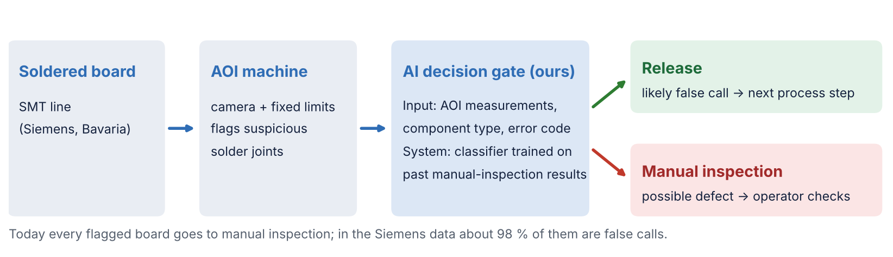
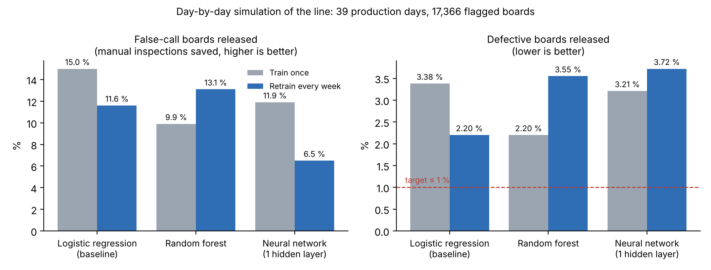
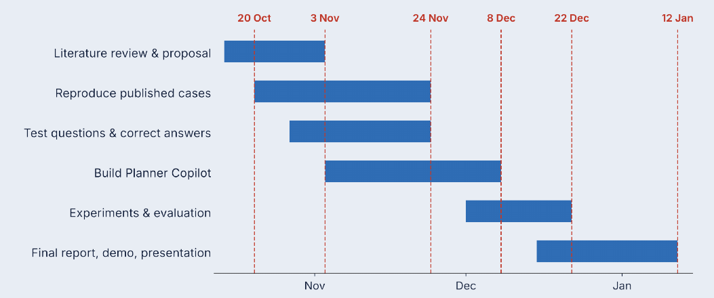

# AI-powered Quality Control and Defect Detection in Electronics Assembly

**Reducing false calls of automated optical inspection (AOI) with an AI decision gate, on Siemens production data**

[](https://github.com/bodhi584/aoi-decision-gate/actions/workflows/ci.yml)

Case Study *Intelligent Systems in Production* · Technische Hochschule Deggendorf (THD) · Team 1 · guided by Dr. Hamidreza Heidari
Yu Han (team lead) · Melisa Subasi · Meron Hagos · Alejandro Rivas

📄 One-page proposal: [`docs/proposal.pdf`](docs/proposal.pdf) ([Word](docs/proposal.docx)) · slides: [`docs/slides_revised_topic.pdf`](docs/slides_revised_topic.pdf) · progress and milestones: [`PROGRESS.md`](PROGRESS.md)

Based on the lecture example **“Siemens – Quality Control and Defect Detection”** (lecture slides, p. 18).

**Aim:** this project aims to explore how an AI-powered decision gate can be integrated after automated optical inspection (AOI) to release false calls on a real Siemens line, while at most 1 % of defective boards are released.

**Key motivations:** reduce dependence on manual quality checks · keep product quality · increase efficiency of the assembly line. Benefits as in the lecture example: *improved product quality, reduced waste, increased efficiency*. Every number on this page comes from a cited source or from a result file in [`results/`](results/).

---

## 1. The industrial problem

After soldering, an **automated optical inspection (AOI)** machine checks every board with a camera. It measures each solder joint (height, offset, polarity, …) and compares each value with fixed limits. If one value is outside its limit, the board goes to a **manual inspection station**, where an operator checks it.

**Most of these alarms are false.** In the Siemens production data used here, about **98 %** of the flagged boards are fine (*false calls*); only about 2 % have a real defect ([`results/data_facts.json`](results/data_facts.json)). The data authors from Siemens describe this as “a major manual labour effort” (Pfab et al. 2024).

**It is a current problem, not a past one:**

| Date | Source | What it says |
|---|---|---|
| 21 Oct 2026 | Siemens press release with NVIDIA | AI second check of AOI results at the **Siemens electronics factory in Erlangen**: when the AOI flags a possible defect, AI decides “whether it represents a real defect or a false call”. Project targets: about **40 % fewer false calls**, **reduced manual verification**. |
| 19 Oct 2026 | Siemens (C. Neike), Erlangen, reported by technology.org | Factories in high-wage countries need **7–9 % more productivity every year**; Siemens invests €500 million in the Erlangen site as a showcase for AI in manufacturing. |
| 2024 | Pfab et al., Siemens AG, *Data in Brief* | Siemens publishes 132 days of AOI data from a real line so that false-call reduction can be studied on real data. |

> **Why this problem and not image-based defect detection?** The AOI machine is already the computer-vision system and stays on the line. The open problem is the step after it: too many false alarms go to people. This is the step Siemens is working on now.

## 2. Key factors

| Factor | Why it matters |
|---|---|
| False-call rate | Each false call costs operator time at the manual station |
| Missed defects | A released defective board reaches the customer; this must stay very low |
| Drift over time | Material batches, machine settings and products change; a model trained last month may no longer fit |
| Class imbalance | Only about 1 % of flagged joints are real defects |
| Label quality | Labels come from operators and may contain errors (Pfab et al. 2024) |

## 3. Input → System → Output



| | |
|---|---|
| **Input** | AOI measurements of each flagged solder joint (about 70 values), inspection type, component type, AOI error code |
| **System** | A classifier trained on past manual-inspection results, plus a release threshold set so that at most 1 % of defective boards are released |
| **Output** | Per board: **release** (skip manual inspection) or **send to manual inspection** |
| **Impact** | Less manual inspection work (cost, throughput) without lowering quality |

> **Why these labels?** They are produced every day at the manual station anyway, so no extra labelling is needed in a factory.

## 4. Methodology

We follow **CRISP-DM** (Cross-Industry Standard Process for Data Mining; Chapman et al. 2000), the standard process for industrial data projects:

| CRISP-DM phase | What we do |
|---|---|
| Business understanding | False-call problem, KPIs and limits (sections 1, 2, 7) |
| Data understanding | Siemens AOI data: structure, imbalance, drift ([`results/data_facts.json`](results/data_facts.json)) |
| Data preparation | Group joints into boards, encode categories, split strictly by time |
| Modelling | Gradient-boosted trees (baseline) and a neural network (planned, PyTorch) |
| Evaluation | **Replay simulation** of the line (section 6) with production KPIs |
| Deployment | Replay demo and run instructions (P5) |

**Replay simulation.** The recorded days are played back in time order. On each day the gate decides every flagged board with a model trained only on earlier days, exactly as on the real line. The gate is updated on a schedule; we compare update policies. Code: [`gate/replay.py`](gate/replay.py).

> **Why a replay instead of a random train/test split?** A random split mixes future and past. It looks much better than reality on this data (section 6), so it would overstate what a factory gets.

## 5. Data

| | |
|---|---|
| Source | Pfab, Eichler, Mallandur, Rothering (2024), Siemens AG, *Data in Brief* 53, 110110 |
| Repository | Mendeley Data, DOI [10.17632/99jzmh9658.2](https://data.mendeley.com/datasets/99jzmh9658/2) |
| Content | 440,274 flagged solder joints on 39,742 boards, 5 inspection types, about 70 AOI measurements, 4 categorical fields (e.g. component type, error code); label: false call / true defect |
| Period | 132 days of one production line of Siemens AG in Bavaria (101 days with records) |
| Drift | A classifier can tell the first 30 % of days from the last 30 % from the measurements alone with AUROC 0.966: the line changes strongly over time |
| Licence | CC BY-NC 3.0, owned by Siemens AG: **not stored here**; [`scripts/download_data.py`](scripts/download_data.py) downloads it and checks the checksum |

## 6. First results

**Baseline** ([`scripts/run_baseline.py`](scripts/run_baseline.py), [`results/baseline.json`](results/baseline.json)): gradient-boosted trees, trained on the first 70 % of the records and tested on the rest, compared with a random split.

| Split | Joint-level AUROC | False-call boards that could be released while 99 % of defective boards still go to manual inspection |
|---|---|---|
| Random 70/30 (as often done in papers) | 0.966 | 29.0 % |
| **Time order (as on the real line)** | **0.889** | **8.2 %** |

These release rates are read from the test period itself, so they are an upper bound.

**Replay simulation** ([`scripts/run_replay.py`](scripts/run_replay.py), [`results/replay.json`](results/replay.json)): second half of the records, thresholds set on past days only.

| Update policy | False-call boards released (manual inspections saved) | Defective boards released |
|---|---|---|
| Train once, never update | 16.4 % (2,750 boards) | **3.89 %** (23 of 592) |
| Retrain weekly on all past days | 14.4 % (2,418 boards) | **4.56 %** (27 of 592) |
| Retrain weekly on the last 28 days | 3.2 % (542 boards) | **2.36 %** (14 of 592) |

Replayed: 39 production days, 17,366 flagged boards (day 85 onwards).



**What this shows:** drift is the main challenge. A threshold that releases at most 1 % of defective boards on past days does not keep that promise on later days. Detecting drift and choosing the right update policy are the core of the project.

## What we deliver

A **software prototype**, not a product installed in a factory:

| Deliverable | What it is |
|---|---|
| **AI decision gate** | A Python package with a command-line tool: `train` on past inspection records, `decide` for one board (RELEASE or INSPECT, with score and main reasons), `replay` the line day by day |
| **Replay dashboard** | A small web app: pick a day of the Siemens line, see each board's decision, manual checks saved, defects released, drift alarms |
| **Evidence** | Result files for every reported number, tests on every push, demo video, final report |

In a factory the gate would run between the AOI machine and the manual inspection station; connecting it to a real line is not part of the course project. Today the package runs as Python modules (`gate/`) and scripts (`scripts/`); the command-line tool and dashboard follow in P3–P5.

## 7. Goals and KPIs

| KPI | Baseline (time order) | Target (12 Jan) |
|---|---|---|
| Defective boards released | 2.4–4.6 % (replay) | **≤ 1 %** |
| False-call boards released (manual inspections saved) | 8.2 % | **≥ 25 %** |
| Drift alarm | none | alarm when performance drops |

Targets are fixed now, before the main experiments.

## 8. Conditions and limitations

- One Siemens production line, five inspection types, 132 days.
- Measurements are anonymised (scaled to 0–1, no physical names), so explanations can name a feature but not its physical meaning.
- Labels come from operators and may contain errors.
- No images: the gate works on AOI measurements, not on camera images.
- Data licence is non-commercial (course use only); no personal data.
- Main risk: drift limits the release rate. Fallback: report which drift handling works, which does not, and why.

## Future work

The next step after the course is a real line with an industry partner: (1) an electronics plant shares AOI and manual-inspection records under a data agreement; (2) an interface reads each board's AOI result from the machine or MES (for example via the IPC-CFX standard or a vendor export) and sends the gate's decision to the repair station; (3) **shadow mode**: the gate runs next to the operators and only logs its decisions; (4) the plant's quality engineers compare the logs and approve go-live, starting with one inspection type.

## 9. Timeline



Milestones follow the course requirements for the Software & Simulation track; details in [`PROGRESS.md`](PROGRESS.md). Tasks are tracked as [issues](../../issues).

## 10. Run it

Runs on **Windows, macOS and Linux** (Python 3.11 or newer, no graphics card). The tests run on all three systems on every push.

```bash
git clone https://github.com/bodhi584/aoi-decision-gate
cd aoi-decision-gate
pip install -r requirements.txt pytest
python -m pytest -q                  # unit tests (synthetic data)
python scripts/download_data.py      # Siemens data, about 330 MB
python scripts/run_baseline.py       # results/baseline.json
python scripts/run_replay.py         # results/replay*.json / .csv
```

## 11. Repository

```
gate/       data loading, decision gate (classifier + threshold), replay simulation
scripts/    data download, baseline, replay
tests/      unit tests (run automatically on every push)
results/    result files of every run shown on this page
docs/       proposal, figures
```

## References

- Pfab, K., Eichler, R., Mallandur, A., Rothering, M. (2024). Data of automated optical inspection of surface-mounted technology electronic production. *Data in Brief* 53, 110110. doi:10.1016/j.dib.2024.110110
- Siemens (21 Oct 2026). *Siemens and NVIDIA advance AI-powered PCB inspection from digital twin to factory.* Press release. https://news.siemens.com/en-us/siemens-nvidia-pcba-digital-twin-factory/
- technology.org (20 Oct 2026). *Siemens aims to raise factory automation to 80 % with AI.* https://www.technology.org/2026/10/20/siemens-ai-factory-automation-80-percent-erlangen-neike/
- Albayari, J., Patra, P., Patel, D., Santos, D. (2025). Enhancing false call detection in automated optical inspection using XGBoost classifier and XAI algorithms. *FAIM 2025*, Springer. doi:10.1007/978-3-032-05610-8_51
- Schmitt, J., Bönig, J., Borggräfe, T., Beitinger, G., Deuse, J. (2020). Predictive model-based quality inspection using machine learning and edge cloud computing. *Advanced Engineering Informatics* 45, 101101.
- Chapman, P. et al. (2000). *CRISP-DM 1.0: Step-by-step data mining guide.* SPSS.
- Lecture slides, Case Study Intelligent Systems in Production, p. 18 (Siemens – Quality Control and Defect Detection).

## License

Code: MIT. The Siemens data are not part of this repository and keep their own licence (CC BY-NC 3.0).
